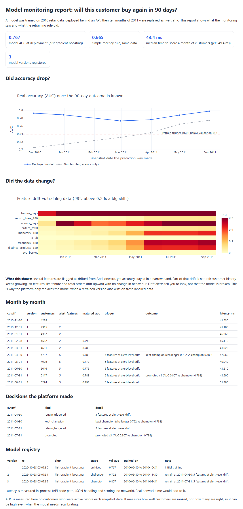

# ML Monitor: train, serve and watch a model in production

Most student ML projects stop at "I trained a model and got an accuracy". This one starts after that. It trains a model, puts it behind an API, replays ten months of real traffic, and watches for the two things that actually break models in production: the data changing and the accuracy dropping. It also decides, by a written rule, when to retrain and whether the new model is good enough to replace the old one.

The model predicts whether a customer of a UK online shop will buy again in the next 90 days. The data is the real Online Retail II dataset (the same one as in my `retail-analytics` project), so the time ordering and the drift are real, not simulated.



Open `outputs/report.html` for the full interactive report.

## What happened when I ran it

| Result | Value |
|---|---|
| Model AUC at deployment (gradient boosting) | 0.767 |
| Simple rule that only looks at how recently the customer bought | 0.665 |
| Customers scored per monthly batch | about 4,200 to 5,200 |
| Median time to score a month of customers through the API code path | 43 ms |
| Model versions registered | 3 (1 champion, 1 rejected challenger, 1 promoted) |

The most useful thing I learned: **from April onward, five features were flagged as drifted, but the model's real accuracy stayed between 0.77 and 0.80.** Part of that drift is natural (customer history keeps growing, so tenure and total orders drift upward without any change in behaviour). A drift alert is a reason to look, not proof that the model is broken. That is why the platform does not swap models on a drift alert alone. In April it trained a challenger and rejected it because it was not clearly better (0.792 vs 0.788). In July a retrained model won more clearly (0.807 vs 0.788) and was promoted.

## How it works

```
sales data -> monthly customer snapshots -> train and compare models -> register champion
                                                                             |
                      API serves the champion  <-----------------------------+
                                  |
              each month: score customers -> measure drift -> measure real accuracy
                          (labels only arrive 90 days later) -> retraining rule -> promote or keep
```

- `mlmon/features.py` builds customer features as they were known on a given date and a label from the following 90 days. A test proves the features cannot see the future.
- `mlmon/train.py` compares a no-learning baseline, logistic regression and four gradient boosting settings. Every model is judged on a later period than it trained on.
- `mlmon/registry.py` is an experiment tracker and model registry on one SQLite file. I chose SQLite over a bigger tool so everything can be inspected with a plain query.
- `mlmon/api.py` is the FastAPI service with `/predict`, `/health` and `/reload`. It logs every batch and its latency, and can pick up a newly promoted model without restarting.
- `mlmon/drift.py` has PSI and KS drift measures, with the usual 0.1 and 0.2 thresholds.
- `mlmon/monitor.py` replays the months and applies the retraining rule.
- `report.py` builds the report.

## The retraining rule

Written down in `monitor.py` so it is a decision and not a feeling:

- Retrain if real AUC drops more than 0.03 below the AUC measured when the model was chosen, or if 3 or more features have PSI of 0.2 or more.
- Do not retrain again within 3 months of the last retrain, because labels take time to arrive.
- Only promote the new model if it beats the current one by at least 0.005 AUC on a recent snapshot it never trained on.

## Run it

```bash
pip install -r requirements.txt
python run_demo.py          # train, deploy, replay 10 months (about a minute)
python report.py            # writes outputs/report.html
python -m pytest tests -q   # 11 tests
uvicorn mlmon.api:app       # run the prediction API on its own
```

A `Dockerfile` is included (`docker build -t ml-monitor .`, then `docker run -p 8000:8000 ml-monitor`). I wrote it but have not built it yet, because Docker was not running on my laptop, so treat it as untested.

## Tests

11 tests cover: PSI behaves correctly for equal, shifted and constant data; features and labels never use future information; the registry promotes and archives correctly; the trained model beats the simple rule; the API returns valid probabilities and rejects missing features and empty batches.

## Limits

- One dataset and one prediction task. The platform code is general but I only tested it on this.
- AUC measures how well customers are ranked, not how well calibrated the probabilities are.
- Latency is measured inside the process (JSON handling and scoring), without network time.
- Feature drift against training data is partly expected here because the customer base keeps ageing. A production system would add a rolling reference window.
- The monthly replay is a simulation of live traffic using real historical data. It is not a deployed system with real users.

Harshit Bihani
